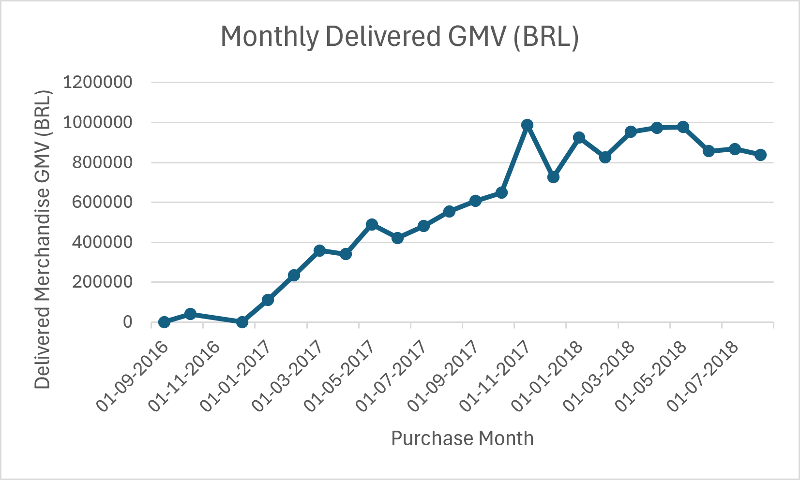
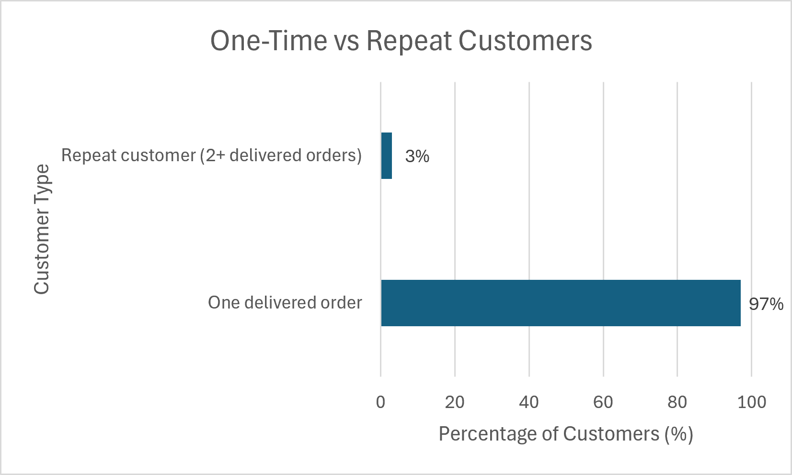
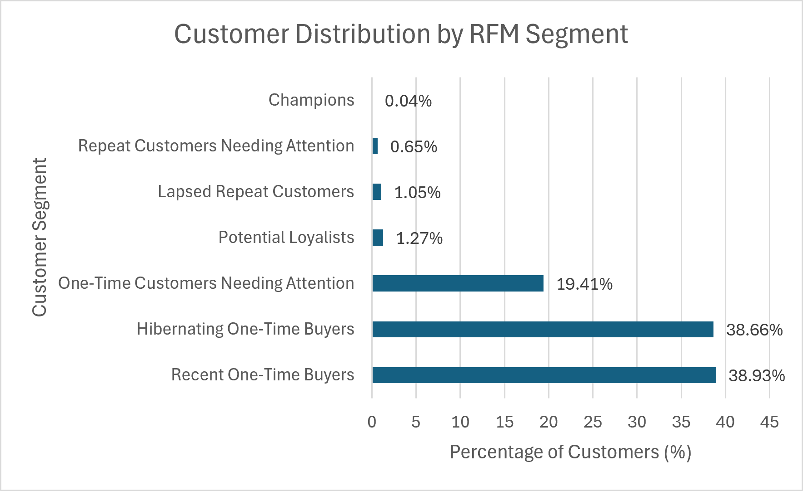
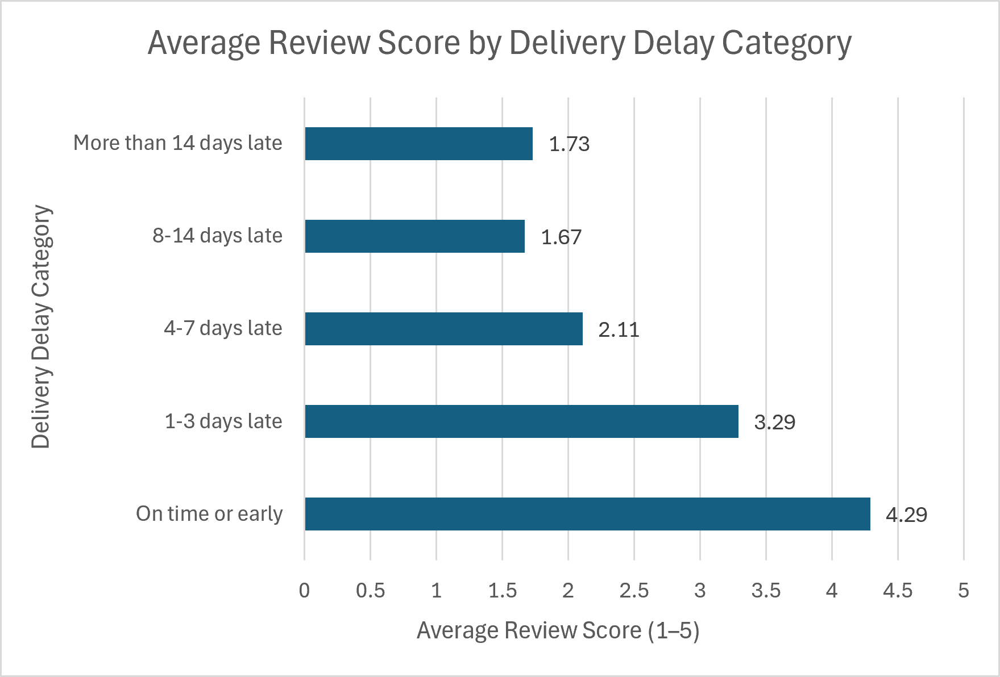

# E-Commerce Retention and Operations Analytics — Olist Dataset

**Tools:** PostgreSQL, pgAdmin 4, SQL  
**Project type:** Exploratory data analysis, customer analytics, revenue analysis and delivery operations analysis

## 1\. Project overview

This project analyses the Brazilian e-commerce public dataset from Olist using PostgreSQL. The goal is to understand how the business performs across orders, merchandise value, payments, repeat purchasing, customer retention, customer segments, delivery operations and customer reviews.

The analysis uses seven related tables and SQL techniques such as joins, common table expressions (CTEs), window functions, date calculations, conditional aggregation, cohort analysis and RFM segmentation.

The project is designed around business questions rather than only writing queries. Each major analysis includes validation checks so that key counts and totals can be compared with the underlying source tables.

## 2\. Business questions

The analysis addresses the following questions:

1. How many orders were placed, and what are the main order statuses?
2. What are the merchandise value, freight value, gross merchandise value (GMV) and average order value (AOV)?
3. Do item totals and recorded payment totals reconcile at the order level?
4. How many customers made repeat purchases, and how does customer activity change across monthly cohorts?
5. Which customers are Champions, Potential Loyalists, one-time buyers or customers needing attention, based on RFM scores?
6. How long do delivered orders take to reach customers, and how frequently do they arrive after the estimated delivery date?
7. Are late deliveries associated with lower customer review scores?
8. How does delivery performance vary by purchase month?

## 3\. Dataset and tables

The project uses these seven core tables:

|Table|Grain / purpose|Rows|
|-|-|-:|
|`olist\_orders`|One row per order|99,441|
|`olist\_customers`|One row per customer-order record; `customer\_unique\_id` identifies the same customer across orders|99,441|
|`olist\_order\_items`|One row per item within an order|112,650|
|`olist\_products`|One row per product|32,951|
|`olist\_sellers`|One row per seller|3,095|
|`olist\_order\_payments`|One row per payment sequence within an order|103,886|
|`olist\_order\_reviews`|One row per review record|99,224|

### Important table-grain details

* `olist\_orders`: `order\_id` is the primary key.
* `olist\_customers`: `customer\_id` is the primary key. Use `customer\_unique\_id` for repeat-purchase and customer-retention analysis because the same real customer can appear under multiple `customer\_id` values.
* `olist\_order\_items`: the primary key is (`order\_id`, `order\_item\_id`). An order can contain multiple item rows.
* `olist\_order\_payments`: the primary key is (`order\_id`, `payment\_sequential`). An order can have multiple payment records.
* `olist\_order\_reviews`: `review\_id` is not unique by itself in this dataset. The project uses (`review\_id`, `order\_id`) as a composite primary key after checking that the pair is unique.

These grain differences matter. Joining raw item rows directly to raw payment rows, for example, can multiply records and inflate totals. For payment reconciliation, item and payment amounts are first aggregated separately to the order level and then joined.

## 4\. Project structure


The repository contains 12 SQL scripts, seven selected PostgreSQL result exports and four visualisations.


```text

olist-ecommerce-analytics/

│

├── outputs/

│   ├── revenue\_analysis/

│   │   └── monthly\_delivered\_revenue.csv

│   │

│   ├── customer\_retention/

│   │   ├── repeat\_purchase\_summary.csv

│   │   └── cohort\_retention\_matrix.csv

│   │

│   ├── rfm\_segmentation/

│   │   └── rfm\_customer\_segments.csv

│   │

│   └── delivery\_review/

│       ├── monthly\_delivery\_performance.csv

│       ├── delivery\_performance\_vs\_review\_scores.csv

│       └── delivery\_delay\_severity\_review\_analysis.csv

│

├── sql/

│   ├── 01\_create\_orders\_tables.sql

│   ├── 02\_create\_customers\_tables.sql

│   ├── 03\_create\_order\_items\_tables.sql

│   ├── 04\_create\_products\_tables.sql

│   ├── 05\_create\_sellers\_tables.sql

│   ├── 06\_create\_order\_payments\_tables.sql

│   ├── 07\_create\_order\_reviews\_tables.sql

│   ├── 08\_revenue\_analysiss.sql

│   ├── 09\_payment\_reconciliations.sql

│   ├── 10\_customer\_retentions.sql

│   ├── 11\_rfm\_segmentations.sql

│   └── 12\_delivery\_review\_analysiss.sql

│

├── visuals/

│   ├── monthly\_delivered\_gmv.png

│   ├── customer\_purchase\_behaviour.png

│   ├── rfm\_customer\_segmentation.png

│   └── delivery\_delay\_customer\_satisfaction.png

│

├── .gitignore

└── README.md

```


\*\*Local data:\*\*


\- Original Olist CSV files are stored locally in `data/raw/` and excluded from this GitHub repository using `.gitignore`.

\- The `outputs/` directory contains selected results exported directly from PostgreSQL.

\- The `visuals/` directory contains charts created using Excel from the actual SQL analysis results.


### Visual Insights

The following charts summarise important findings from the analysis.

#### 1. Monthly Delivered GMV

Shows the monthly trend in delivered merchandise value, excluding freight charges.



#### 2. Customer Purchase Behaviour

Compares one-time customers with customers who made two or more delivered purchases.



#### 3. RFM Customer Segmentation

Shows the distribution of customers across the seven populated RFM segments, based on the historical October 18, 2018 snapshot.



#### 4. Delivery Delay and Customer Satisfaction

Compares average customer review scores across different delivery-delay categories. The results show an association, not proof of causation.




## 5\. Tools and SQL skills used

* **PostgreSQL:** relational database used to store and analyse the data.
* **pgAdmin 4:** database connection, table creation, CSV imports and query execution.
* **Joins:** connect orders with customers, items, products, sellers, payments and reviews.
* **CTEs (`WITH`):** split multi-step analysis into readable stages.
* **Window functions:** calculate customer scoring distributions, percentages and cohort metrics.
* **Conditional aggregation and `FILTER`:** calculate order statuses, data-quality counts and review categories.
* **Date and timestamp functions:** calculate delivery duration, purchase months and cohort age.
* **`CASE`:** create frequency scores, delivery categories and customer segments.
* **`CUME\_DIST()`:** create Recency and Monetary score bands while keeping customers with tied metric values in the same distribution group.
* **`PERCENTILE\_CONT()`:** calculate median delivery durations and review scores.
* **Reconciliation:** compare order-level merchandise-plus-freight totals against order-level payment totals.

## 6\. Analysis workflow and key findings

### A. Data setup, inspection and validation

Seven CSV datasets were imported into PostgreSQL. The analysis checked table row counts, key uniqueness, missing values and relationships between related tables.

Examples of validation results:

* 99,441 orders and 99,441 customer-order records were loaded.
* 96,096 distinct `customer\_unique\_id` values were present in the customer table.
* 112,650 order-item rows represented 98,666 distinct orders with items.
* 103,886 payment records represented 99,440 orders with payment records.
* 99,224 review records represented 98,673 orders with reviews.
* No order-item rows were found without a matching order, product or seller in the checks performed.

### B. Revenue and order-value analysis

The analysis calculated merchandise value, freight value and average merchandise value per order from the order-item table.

|Metric|Result|
|-|-:|
|Merchandise value across all item records / statuses|R$13,591,643.70|
|Freight value across all item records / statuses|R$2,251,909.54|
|Merchandise plus freight across all item records / statuses|R$15,843,553.24|
|Average merchandise value per order with items (all statuses)|R$137.75|
|Delivered merchandise GMV|R$13,221,498.11|
|Delivered orders with items|96,478|
|Delivered AOV (merchandise only)|R$137.04|

**Metric definition:** The AOV values above use merchandise price only and exclude freight. The all-status totals include item records across recorded order statuses, so they should not be described as delivered revenue or recognised accounting revenue.

### C. Payment reconciliation

Item totals and payment totals were aggregated separately by `order\_id` and then compared.

|Reconciliation measure|Result|
|-|-:|
|Orders in either item or payment table|99,441|
|Orders with item records|98,666|
|Orders with payment records|99,440|
|Orders with both|98,665|
|Orders with items but no payment record|1|
|Orders with payment records but no item records|775|
|Total recorded payments|R$16,008,872.12|
|Merchandise plus freight across item records|R$15,843,553.24|
|Difference between those two overall totals|R$165,318.88|
|Matched orders with a difference greater than R$0.01|303|
|Net payment-minus-item-plus-freight difference among matched orders|R$2,870.39|
|Largest absolute individual matched-order difference|R$182.81|

The overall difference is not fully explained by the matched-order differences. The two totals have different populations because some orders have payments without item records and one order has item records without a payment record. The remaining matched-order differences were investigated, but their causes were not established from the available columns. They are therefore documented as unresolved reconciliation differences rather than treated as errors with a known cause.

### D. Repeat purchase and cohort retention analysis

Repeat purchasing was measured using `customer\_unique\_id` and delivered orders.

|Customer type|Customers|Share|
|-|-:|-:|
|One delivered order|90,557|97.00%|
|Repeat customers (2+ delivered orders)|2,801|3.00%|
|**Total**|**93,358**|**100.00%**|

Monthly cohorts were formed using each customer's first observed delivered-purchase month in the dataset. Retention measures the share of that cohort with another delivered purchase in each later calendar month.

**Interpretation note:** These are first observed purchases within the dataset, not verified lifetime-first purchases. The analysis uses calendar-month activity; it is not a rolling-day retention measure. Months beyond the dataset's last observed delivered-purchase month are not treated as zero-retention periods.

### E. RFM customer segmentation

RFM metrics were calculated for 93,358 customers with at least one delivered order. The historical snapshot date is **October 18, 2018**, one day after the latest recorded order-purchase date in the dataset.

* **Recency:** number of days between October 18, 2018 and the customer's most recent delivered order purchase date.
* **Frequency:** number of distinct delivered orders per `customer\_unique\_id`.
* **Monetary:** sum of item `price` values across delivered orders. Freight is excluded.

Scoring approach:

* Frequency uses explicit rules: 1 order = score 1; 2 = score 2; 3 = score 3; 4 = score 4; 5 or more = score 5. This avoids splitting the large group of one-time buyers across different Frequency scores.
* Recency uses `CUME\_DIST()` ordered from highest days since purchase to lowest, so more recent customers receive higher scores.
* Monetary uses `CUME\_DIST()` ordered from lower to higher merchandise spend, so higher spenders receive higher scores.
* `CUME\_DIST()` keeps tied Recency and Monetary values together, so resulting groups may not contain exactly 20% of customers.

The project uses explicit, mutually exclusive segment rules. The results were:

|Customer segment|Customers|Customer share|Merchandise contribution|
|-|-:|-:|-:|
|Recent One-Time Buyers|36,345|38.93%|38.59%|
|Hibernating One-Time Buyers|36,094|38.66%|38.12%|
|One-Time Customers Needing Attention|18,118|19.41%|17.78%|
|Potential Loyalists|1,181|1.27%|2.30%|
|Lapsed Repeat Customers|982|1.05%|1.83%|
|Repeat Customers Needing Attention|605|0.65%|1.20%|
|Champions|33|0.04%|0.18%|
|Loyal Repeat Customers|0|0.00%|0.00%|
|**Total**|**93,358**|**100.01%**\*|**100.00%**|

\*Customer-share percentages sum to 100.01% because each segment percentage is rounded to two decimal places. Segment definitions are project-specific rules, not universal industry standards.

**Business interpretation:** 97% of customers made one delivered purchase in the observed dataset. This points to a potential opportunity to encourage a second purchase. It does not, by itself, explain why customers did not return.

### F. Delivery performance and customer reviews

Delivery performance was calculated for delivered orders with both actual and estimated delivery dates. Eight delivered orders had a missing actual delivery date and were excluded from delivery-duration and on-time/late comparisons. No missing estimated delivery dates or actual-delivery-before-purchase cases were found in the validation query.

|Metric|Result|
|-|-:|
|Delivered orders with complete delivery dates|96,470|
|On-time or early orders|89,936 (93.23%)|
|Late orders|6,534 (6.77%)|
|Average actual delivery duration|12.56 days|
|Median actual delivery duration|10.22 days|
|Average estimated delivery duration|23.74 days|
|Average calendar-day variance (actual minus estimate)|-11.88 days|
|Average calendar days late, among late orders only|10.62 days|
|Longest recorded actual delivery duration|209.63 days|

On-time/late classification compares calendar dates: actual delivery date on or before the estimated delivery date is on time or early; a later calendar date is late. Actual delivery duration uses the full timestamps, so it includes fractional days.

The 15 longest deliveries were inspected using purchase, carrier-handover and customer-delivery timestamps. In those 15 records, the carrier-handover timestamp was chronologically between purchase and customer delivery. The largest recorded post-handover intervals were substantial; the available timestamps do not establish the underlying cause.

#### Delivery and review relationship

The overall review table contained 99,224 review records, with an average review score of 4.09 out of 5. For delivery comparisons, review scores were first averaged by order so that an order with multiple review records did not receive extra weight in the order-level average.

|Delivery category|Reviewed orders|Average order review score|Median order review score|
|-|-:|-:|-:|
|On time or early|89,443|4.29|5.00|
|Late|6,381|2.27|1.00|

Order-level satisfaction categories showed:

|Delivery category|Low-rated (average ≤ 2)|Moderate (average > 2 and < 4)|Positive (average ≥ 4)|
|-|-:|-:|-:|
|On time or early|9.23%|8.13%|82.64%|
|Late|62.36%|10.91%|26.74%|

When late deliveries were divided by delay severity, the average order review scores were:

|Delivery category|Reviewed orders|Average order review score|Low-rated orders|
|-|-:|-:|-:|
|On time or early|89,443|4.29|9.23%|
|1–3 days late|1,852|3.29|32.18%|
|4–7 days late|1,748|2.11|67.56%|
|8–14 days late|1,446|1.67|80.08%|
|More than 14 days late|1,335|1.73|78.20%|

**Interpretation:** Late deliveries are associated with lower review scores in this dataset. This is an observational comparison and does not prove that delivery delays alone caused lower ratings. Other factors, such as product or seller experience, may also influence reviews.

#### Monthly delivery performance

The monthly analysis groups orders by purchase month. March 2018 had the highest late-delivery percentage among the reported months: **18.96% (1,328 late orders out of 7,003 eligible delivered orders)**. February 2018 was 14.13%, and November 2017 was 12.40%.

The dataset's delivered-purchase activity ends on August 29, 2018. The earliest and latest months are partial periods, and months absent from the result have no eligible delivered orders in the query output. Monthly patterns should be interpreted with order volume in mind.

## 7\. How to run the project

1. Install PostgreSQL and pgAdmin 4.
2. Download and extract the Olist public dataset separately. Keep the original CSV files in `data/raw/` locally.
3. Create a PostgreSQL database named `olist\_analytics`.
4. Open the SQL files in the `sql/` folder and execute the table-creation scripts in order. The orders table must exist before tables that reference it; the order-items table must exist before product and seller foreign keys are added.
5. Import each corresponding CSV into its table using pgAdmin's Import/Export tool. The project used CSV headers, comma delimiter, double-quote quote/escape characters and UTF-8 encoding.
6. Run the validation queries in the setup scripts and confirm that row counts and relationships match the documented results.
7. Run the analysis scripts:

   * 08\_revenue\_analysiss.sql
   * 09\_payment\_reconciliations.sql
   * 10\_customer\_retentions.sql
   * 11\_rfm\_segmentations.sql
   * 12\_delivery\_review\_analysiss.sql

The CSV loading was performed through pgAdmin rather than automated by the SQL scripts. The setup scripts are intended for initial table creation; do not assume they can be rerun unchanged against an already-created database because `CREATE TABLE` and constraint statements may fail when the objects already exist.

## 8\. Data-quality notes and limitations

* Product attributes contain missing values: 610 products have missing category values; two products have missing weight values and missing at least one dimension. These values were profiled rather than silently imputed.
* Review IDs are not unique by themselves in the source. The review/order pair was checked and used as a composite key.
* Eight delivered orders have no actual customer-delivery timestamp. They are excluded from delivery-duration and on-time/late calculations.
* Payment and item totals do not fully reconcile. The payment-only and item-only orders, as well as the 303 matched orders with differences greater than R$0.01, are documented. The causes of all matched-order differences were not established.
* The RFM model is a historical snapshot at October 18, 2018, and uses delivered orders only. Monetary value means item merchandise price, excluding freight.
* Cohort retention is based on first observed delivered-purchase month within this dataset and calendar-month activity. It should not be interpreted as verified lifetime retention.
* Delivery versus review comparisons show association, not causation.
* Monthly delivery rates are based on eligible delivered orders with complete date fields. Partial months and small monthly counts require caution.

## 9\. Suggested business actions

Based on the observed patterns, the following actions could be tested by an e-commerce business:

1. **Encourage a second purchase:** test relevant follow-up recommendations or targeted incentives for one-time buyers, then measure whether their repeat-purchase rate improves.
2. **Prioritise delivery reliability:** investigate carrier routes and handover-to-customer intervals for delayed orders, particularly in months with elevated late-delivery rates.
3. **Prioritise severe delays:** monitor orders approaching 4, 8 and 14 days beyond their estimated delivery dates and proactively communicate revised delivery expectations.
4. **Retain high-value customers:** consider loyalty benefits or personalised communication for Champions and Potential Loyalists.
5. **Monitor operational and customer KPIs together:** track late-delivery rate alongside average order review score and low-rated-order percentage.

These are recommendations for future testing; this project does not measure the impact of any campaign or operational intervention.

## 10\. Conclusion

This PostgreSQL project brings together revenue analysis, payment reconciliation, repeat-purchase and cohort analysis, RFM segmentation, delivery-performance analysis and customer-review analysis. It demonstrates how SQL can be used not only to retrieve records, but also to validate data, avoid double-counting, define customer groups and translate operational patterns into business questions and recommendations.

